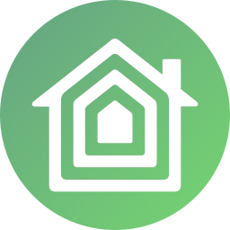

[](https://github.com/Geek-MD/HomeKit_Bridge)
[](https://github.com/Geek-MD/HomeKit_Bridge)
[](https://github.com/Geek-MD/HomeKit_Bridge)

[](https://github.com/Geek-MD/HomeKit_Bridge/releases)
[](https://github.com/Geek-MD/HomeKit_Bridge/blob/main/LICENSE)
[](https://hacs.xyz/)

[](https://github.com/Geek-MD/HomeKit_Bridge/actions/workflows/ci.yaml)
[](https://github.com/Geek-MD/HomeKit_Bridge/actions/workflows/validate.yaml)

<!-- ha-marketplace:exclude-start -->
[](https://my.home-assistant.io/redirect/marketplace_repository/?owner=Geek-MD&repository=HomeKit_Bridge&category=integration)
<!-- ha-marketplace:exclude-end -->



# HomeKit Child Bridge

A custom Home Assistant integration that publishes groups of entities as separate
Apple Home bridges. Each entry creates a native `homekit` entry, so Home Assistant
provides an independent QR code and pairing code for every group.

## Version 0.4.2

This README documents **HomeKit Child Bridge 0.4.2**. This release adds the
classification metadata used by the Home Assistant 2026.11 Marketplace. It also
includes the combined domain/integration selector and entity-group choice added
in 0.4.1.

## 📋 Requirements

- Home Assistant 2025.1.0 or newer.
- The built-in HomeKit integration.
- An Apple Home hub is recommended for remote access and automations.

## ✨ Features

- Export all entities from a domain (`light`, `cover`, and so on).
- Export the entities that belong to a configured integration.
- Create an independent HomeKit bridge for every selection.
- Configure multiple instances, each with its own bridge, port, and pairing code.
- Reconfigure an existing instance without replacing its managed bridge.
- Include entity groups, or ignore them while still exporting their individual
  members.
- Read the Apple Home setup code from the instance's pairing-code sensor.
- Automatically remove the managed bridge when its group is deleted.
- Reuse Home Assistant's built-in HomeKit implementation instead of running an
  alternative HAP server.
- Configuration UI translations for English, Spanish, German, Italian, French,
  and Portuguese.

This integration replaces the need to configure groups directly through the base
`homekit` integration. Its manifest declares `homekit` as a dependency, and the
integration uses Home Assistant's native HAP implementation internally to retain
compatibility with Home Assistant and Apple Home.

See the [0.4.2 changelog](CHANGELOG.md#042---2026-11-09) for the complete release
notes.

## 🛠 Installation

### Option 1: Marketplace (Home Assistant 2026.11 or newer)

1. Go to **Settings → Marketplace**.
2. Search for **HomeKit Child Bridge**, select **Install**, and confirm version **0.4.2**.
3. Complete setup when Home Assistant opens the integration page.

### Option 2: HACS (Home Assistant 2026.10 or older)

1. Add this repository to HACS as a custom integration repository.
2. Search for **HomeKit Child Bridge** and install version **0.4.2**.
3. Restart Home Assistant.

### Option 3: Manual installation

1. Copy `custom_components/homekit_child_bridge` into Home Assistant's
   `custom_components` directory.
2. Restart Home Assistant.

## ⚙️ Configuration

1. Go to **Settings → Devices & services → Add integration** and search for
   **HomeKit Child Bridge**.
2. Select a domain or configured integration and decide whether aggregate entity
   groups or helpers should also be included in the same dialog.
3. Open the new **HomeKit Bridge** entry created by Home Assistant and scan its QR
   code.

Home Assistant's native HomeKit integration presents the QR code while an
unpaired bridge is ready for pairing. The same numeric setup code remains
available in the **Pairing code** sensor created under the HomeKit Child Bridge
device.

For example, if `light.dining_room` groups three individual lights, disabling
**Include entity groups** keeps the three member lights in the bridge and omits
only `light.dining_room`. This option is disabled by default for new bridges.
Existing bridges retain their previous behavior until they are reconfigured.

To change an instance later, open **Settings → Devices & services**, select its
HomeKit Child Bridge entry, open the overflow menu, and choose **Reconfigure**.
You can add further instances from **Add integration**; an exported group can only
belong to one instance.

> Do not configure the same entities in multiple HomeKit bridges. Apple Home will
> display them as duplicates.

## 🌐 Supported languages

Version 0.4.2 includes configuration UI translations for:

- English
- French
- German
- Italian
- Portuguese
- Spanish

## Development for 0.4.2

```bash
python -m pip install -e '.[test]'
pytest
ruff check .
```

The integration version is defined in
`custom_components/homekit_child_bridge/manifest.json`. Any behavior added after
Changes for 0.4.2 must be documented in the changelog for its corresponding release.

Pull requests and pushes are checked by the same `ci.yaml` and `validate.yaml`
workflows used by Battery Devices Monitor. They run Ruff, pytest, hassfest, and
HACS validation; validation is also scheduled daily.

## 📜 License

MIT
